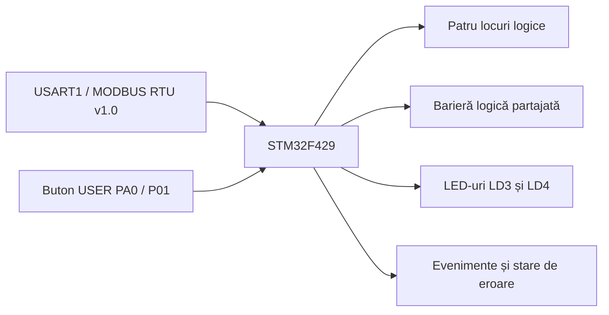
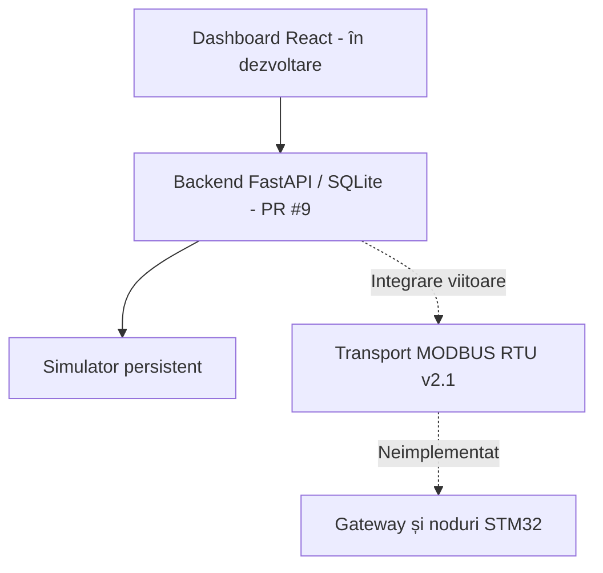

# STM32 Smart Parking

**Sistem de parcare inteligentă cu firmware STM32F429, comunicație MODBUS RTU și componente software pentru monitorizare și simulare.**

**Disciplina:** Proiectarea Sistemelor Înglobate  
**Organizație:** PSI-2026  
**Echipă:** 3 studenți  
**Stadiu:** prototip firmware testat automat; integrarea completă este în dezvoltare  
**Platforme de dezvoltare:** macOS și Windows

> **Important:** Funcțiile software și testele native nu reprezintă validare pe placa fizică. Actuatoarele barierei și ieșirea fizică pentru buzzer sunt dezactivate în configurația actuală. Plățile sunt exclusiv simulate.

## Despre proiect

Proiectul urmărește gestionarea unei parcări cu **patru locuri logice**, controlul accesului, evidența sesiunilor și calcularea costurilor, cu o interfață web și un backend care vor comunica ulterior cu microcontrolerul.

În versiunea de firmware integrată în `main`:

- **P01** este reprezentat, pentru testele de laborator, de butonul **USER (PA0)** al plăcii STM32; acesta nu este un senzor de parcare instalat.
- **P02–P04** sunt locuri simulate, pentru care firmware-ul poate primi stări prin registre MODBUS. Integrarea efectivă cu backend-ul nu este încă realizată.
- O **singură barieră logică partajată** gestionează cererile de intrare și ieșire. Două bariere fizice separate fac parte din arhitectura țintă, nu din implementarea actuală.
- Starea necunoscută sau expirată a locurilor nu este considerată „liber”; intrarea este blocată când capacitatea nu poate fi verificată.

## Stadiul implementării

| Componentă | Stadiu | Detalii |
| --- | --- | --- |
| Firmware STM32F429 | **Implementat în `main`** | Parcare hibridă, barieră logică, buzzer neblocant, evenimente și tratarea erorilor |
| MODBUS RTU Slave v1.0 | **Implementat în `main`** | USART1, 115200 8N1, funcțiile **03** și **06**, verificare CRC, delimitare RTU cu DWT |
| Teste firmware | **Automatizate în `main`** | Șase executabile de test native, AddressSanitizer, UndefinedBehaviorSanitizer, `clang-tidy` |
| Backend FastAPI + SQLite | **În Pull Request #9** | API de parcare, sesiuni, plăți simulate, simulator persistent; nu este încă în `main` |
| Frontend React + TypeScript | **În branch separat** | `feature/frontend-dashboard`; nu este încă în `main` |
| Integrare hardware MODBUS | **Nevalidată** | Transportul fizic și compatibilitatea cu protocolul țintă necesită dezvoltare și testare |
| Bariere și buzzer fizice | **Dezactivate** | Nu se activează până la verificarea senzorilor, interblocărilor și circuitelor |

Codul backend propus se află în [PR #9 — FastAPI backend și simulator](https://github.com/PSI-2026/STM32-Smart-Parking/pull/9), iar interfața web se dezvoltă în [branch-ul frontend](https://github.com/PSI-2026/STM32-Smart-Parking/tree/feature/frontend-dashboard). Aceste componente **nu trebuie confundate cu fișierele disponibile în `main`**, unde directoarele `backend/` și `frontend/` sunt momentan rezervate.

## Arhitectură

### Firmware implementat



Firmware-ul rulează implicit în `GATE_SIMULATION`; **nu acționează fizic o barieră**. Stările P02–P04 pot fi actualizate prin protocol, dar nu există încă o integrare hardware–backend demonstrată.

### Arhitectura software vizată



**Atenție la compatibilitate:** firmware-ul integrat utilizează **MODBUS v1.0 (FC03/FC06)** și o singură poartă logică. Contractul backend propune **MODBUS distribuit v2.1**, cu identitate pentru gateway și nodurile S1–S5, observații atomice **FC04** și comenzi **FC16**. Cele două profiluri **nu sunt compatibile direct**. Nu trebuie trimise comenzi hardware v2.1 către firmware-ul actual și nu trebuie activat un fallback implicit la v1.0.

Citiți [matricea de compatibilitate firmware–backend](docs/firmware/COMPATIBILITATE_BACKEND.md) înainte de implementarea transportului fizic.

## Tehnologii

| Domeniu | Tehnologii |
| --- | --- |
| Hardware / firmware | STM32F429, ARM Cortex-M4, C11, STM32 HAL, STM32CubeMX / STM32CubeIDE |
| Protocol implementat | MODBUS RTU Slave v1.0 prin USART1 |
| Testare firmware | Teste native C, ASan, UBSan, `clang-tidy`, GitHub Actions |
| Backend în dezvoltare | Python, FastAPI, SQLite, simulator persistent (PR #9) |
| Frontend în dezvoltare | React, TypeScript, Vite (branch separat) |
| Simulare și depanare | Renode, GDB; ghidul existent descrie un scenariu mai vechi pentru PARK1 |
| Colaborare | Git, GitHub, Pull Requests |

## Structura repository-ului

```text
STM32-Smart-Parking/
├── firmware/
│   ├── STM32_SmartParking/  # Proiect STM32CubeIDE, Core, HAL, App și .ioc
│   └── tests/               # Teste native și analiză statică
├── backend/                 # Rezervat în main; implementarea este în PR #9
├── frontend/                # Rezervat în main; implementarea este într-un branch
├── simulation/renode/       # Rezervat pentru scenarii Renode
├── docs/
│   ├── firmware/            # Arhitectură, registre, pinout, teste și validare
│   └── RENODE_SETUP_AND_TESTING.md
└── .github/workflows/       # CI pentru firmware
```

## Pornire și testare

### 1. Clonarea proiectului

```bash
git clone https://github.com/PSI-2026/STM32-Smart-Parking.git
cd STM32-Smart-Parking
```

### 2. Testele native pentru firmware

Sunt necesare un compilator C11, `make` și `clang-tidy`. Pentru testele cu sanitizatoare este necesar și un compilator cu suport ASan/UBSan.

```bash
make -C firmware/tests test      # Teste unitare native
make -C firmware/tests sanitize  # AddressSanitizer + UndefinedBehaviorSanitizer
make -C firmware/tests analyze   # Analiză statică clang-tidy
make -C firmware/tests check     # Toate verificările de mai sus
```

Fluxul [GitHub Actions](.github/workflows/firmware-native-tests.yml) execută aceste verificări la Pull Requests către `main`. **Aceste teste nu verifică UART-ul sau senzorii pe placa fizică.**

### 3. Deschiderea proiectului STM32

În **STM32CubeIDE**, importați proiectul existent din:

```text
firmware/STM32_SmartParking/
```

Verificați includerea tuturor surselor noi din `App/Src` în configurațiile **Debug** și **Release**. Cross-build-urile ARM efectuate în cadrul reviziilor anterioare nu înlocuiesc un build curat gestionat de STM32CubeIDE. Nu considerați dispozitivul validat înainte de testele de pe placă.

Ghidul [Renode și GDB](docs/RENODE_SETUP_AND_TESTING.md) documentează o etapă istorică de testare PARK1; **nu reprezintă o demonstrație completă a arhitecturii hibride actuale**.

## Documentație tehnică

- [Arhitectura firmware](docs/firmware/ARCHITECTURA.md)
- [Harta registrelor MODBUS v1.0](docs/firmware/MODBUS_REGISTER_MAP.md)
- [Compatibilitate firmware v1.0 / backend v2.1](docs/firmware/COMPATIBILITATE_BACKEND.md)
- [Pini și conexiuni hardware](docs/firmware/PINOUT.md)
- [Mașinile de stări](docs/firmware/STATE_MACHINES.md)
- [Testare firmware](docs/firmware/TESTARE.md)
- [Validare pe placa fizică — checklist](docs/firmware/VALIDARE_HARDWARE.md)

## Pașii următori

- [x] Structura proiectului și firmware de bază.
- [x] Parcare hibridă, barieră logică partajată și MODBUS RTU v1.0.
- [x] Teste native, sanitizatoare și analiză statică integrate în CI.
- [x] Documentarea diferențelor dintre firmware v1.0 și contractul backend v2.1.
- [ ] Integrarea în `main` a backend-ului și a frontend-ului după review și teste.
- [ ] Definirea și implementarea compatibilității firmware–backend pentru profilul MODBUS distribuit v2.1.
- [ ] Validarea pe hardware a comunicației USART, a temporizării și a recuperării după erori.
- [ ] Validarea senzorilor, a siguranței și a controlului fizic al barierelor.
- [ ] Teste end-to-end pentru dashboard, backend, transport și dispozitive.

## Colaborare

Proiectul este dezvoltat de o echipă de trei studenți, cu activități în firmware, backend/comunicație și frontend. Modificările se pregătesc în branch-uri separate și se integrează prin Pull Requests, după review și verificările relevante.

Nu includeți în commit fișierele compilate, directoarele `Debug`/`Release`, mediile virtuale, datele locale sau setările CubeIDE specifice fiecărui calculator.

---

**Notă:** Nu sunt efectuate plăți bancare reale. Recunoașterea automată a numerelor de înmatriculare este o posibilă extindere, nu o funcție implementată.
