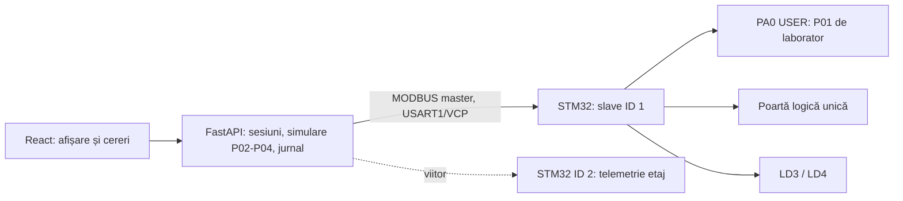

# Arhitectura firmware hibrid

## Responsabilități și surse de adevăr

P01 este citit local din butonul USER (PA0) în configurația de laborator. P02–P04 aparțin backendului și intră numai prin registrele validate MODBUS. Starea necunoscută nu este liberă. Backendul păstrează sesiunile, agregarea între noduri, jurnalul și sincronizarea frontendului. Firmwareul păstrează starea fizică P01, ciclul porții, defectele și ultimele evenimente numerotate.

Codul vechi `parking_manager` și `barrier_controller` este păstrat pentru teste și migrare, dar bucla principală folosește `hybrid_parking`, `shared_gate`, `modbus_slave` și `buzzer`. Nu se alocă memorie dinamică. Identitatea se poate configura la compilare prin `PARKING_NODE_ID` (1 implicit); nodul 2 nu expune o poartă și poate primi stări simulate pentru patru poziții până la instalarea unor senzori proprii.

## Politică de siguranță

Modul implicit este `GATE_SIMULATION`. Niciun pin de actuator și niciun pin de buzzer nu este comandat. Modul `GATE_HARDWARE` există în nucleul portabil, dar activarea sa cere un senzor de trecere verificat, poziții limită, interblocare și etaj de putere aprobate. O comandă de trecere simulată în acest mod produce defect. La pierderea comunicației se invalidează datele simulate; intrarea se refuză până la restaurarea întregii capacități. Ieșirea rămâne permisă dacă poarta este disponibilă.

## Contract backend

Masterul citește periodic 0x0000–0x0010 și coada de evenimente 0x0020–0x002F. Actualizează P02–P04 cel puțin la 5 s; recomandat 1 s. Trimite o secvență nenulă la 0x0100, apoi o direcție la 0x0101. Răspunsul la comandă înseamnă acceptare, nu trecere finalizată. Confirmarea vine numai după detectarea trecerii, 500 ms de eliberare și incrementarea contorului 0x000C. Backendul deduplică evenimentele după perechea `(node_id, event_sequence)` și marchează lacunele dacă 0x0010 indică suprascrierea cozii.

Frontendul nu comunică direct cu MCU. Când nodul 2 este offline, backendul marchează etajul necunoscut și nu îl adună ca liber.
