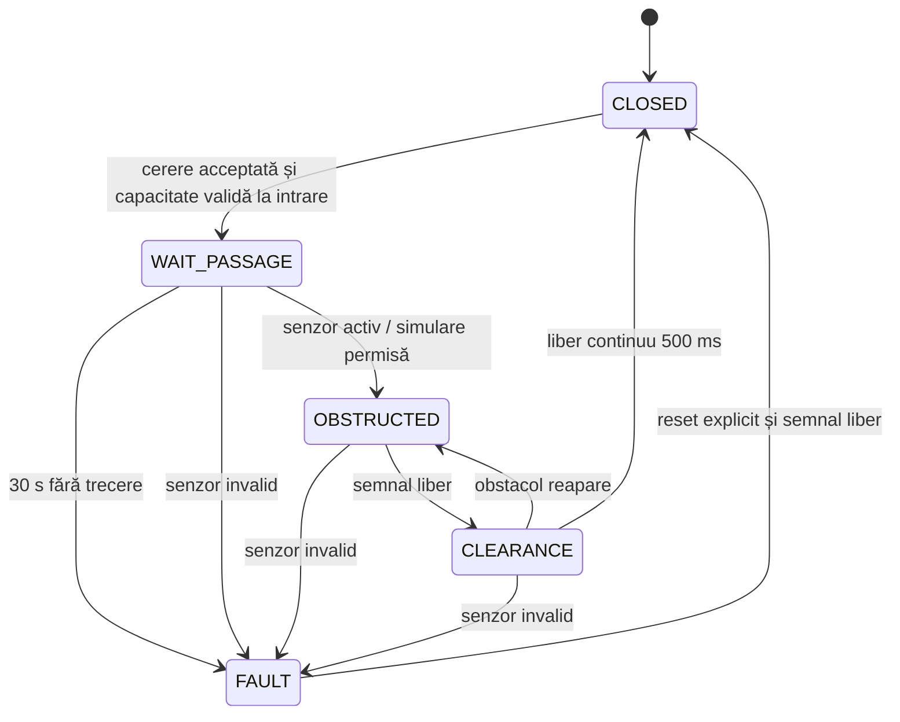

# Mașini de stare

O singură direcție este activă per ciclu. Cererile conflictuale sunt refuzate; repetarea unei secvențe acceptate returnează duplicat, iar repetarea unei secvențe refuzate rămâne refuzată. Pentru o nouă încercare, masterul folosește o secvență nouă. Intrarea cere toate cele patru stări cunoscute și cel puțin un loc liber. Ieșirea nu verifică numărul de locuri libere. Evenimentul „finalizat” apare numai după detectarea trecerii și închiderea logică. La defect, starea logică rămâne în defect și nu se comandă mecanic închiderea.

Pentru buzzerul opțional, tranzițiile confirmate produc 1/2/3 impulsuri pentru deschis/închis/defect, cu impuls și pauză de 100 ms. Secvența de eveniment previne repetarea aceluiași sunet. Ieșirea fizică este dezactivată implicit.
